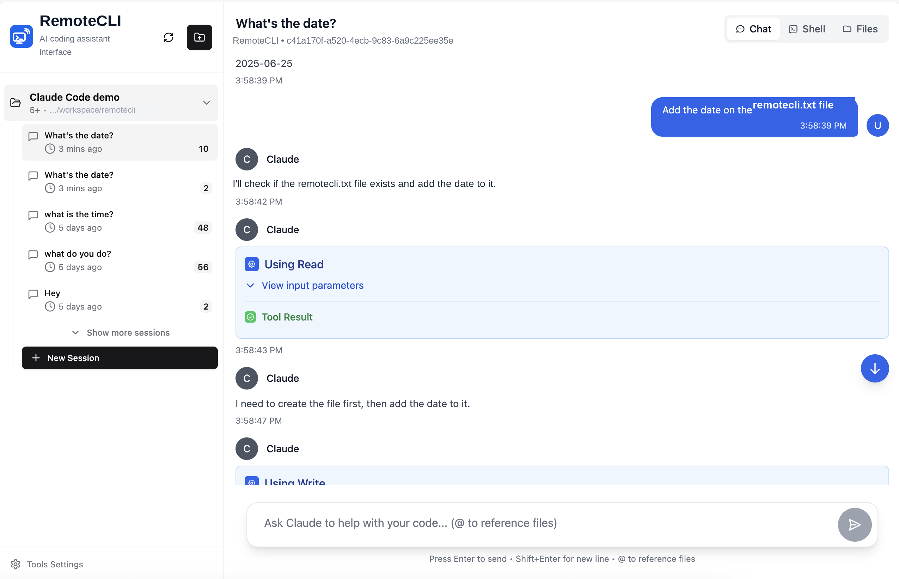
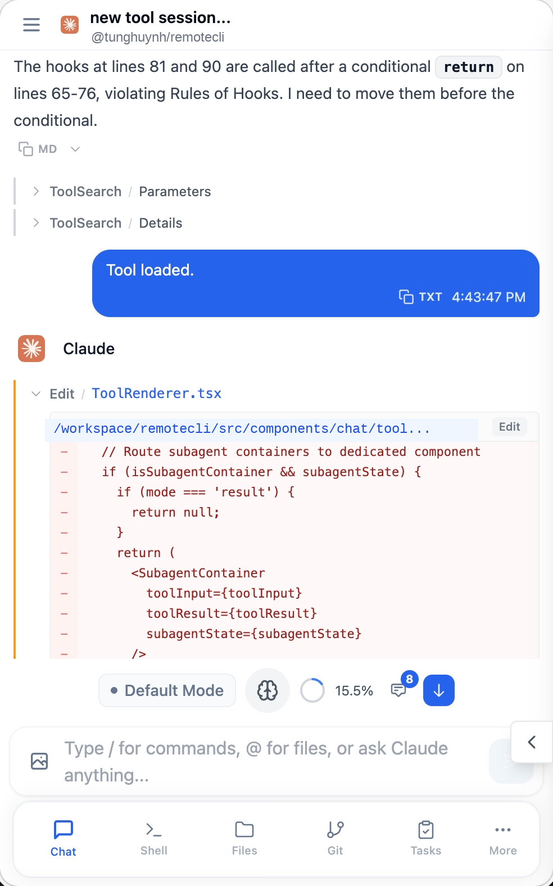
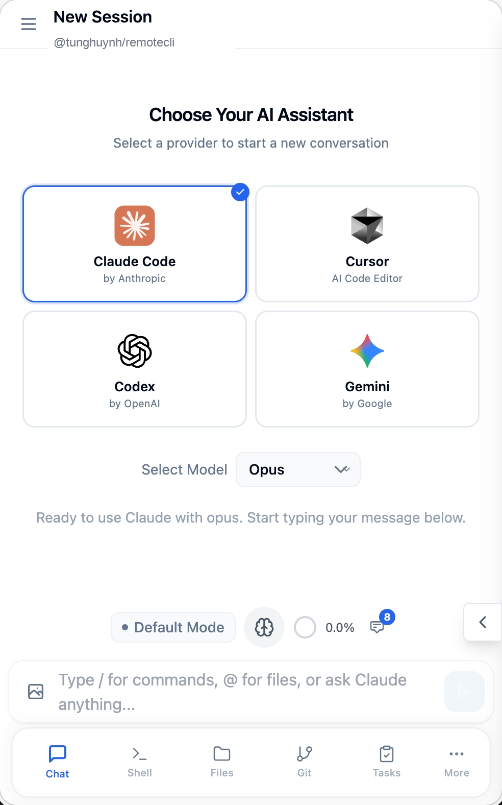
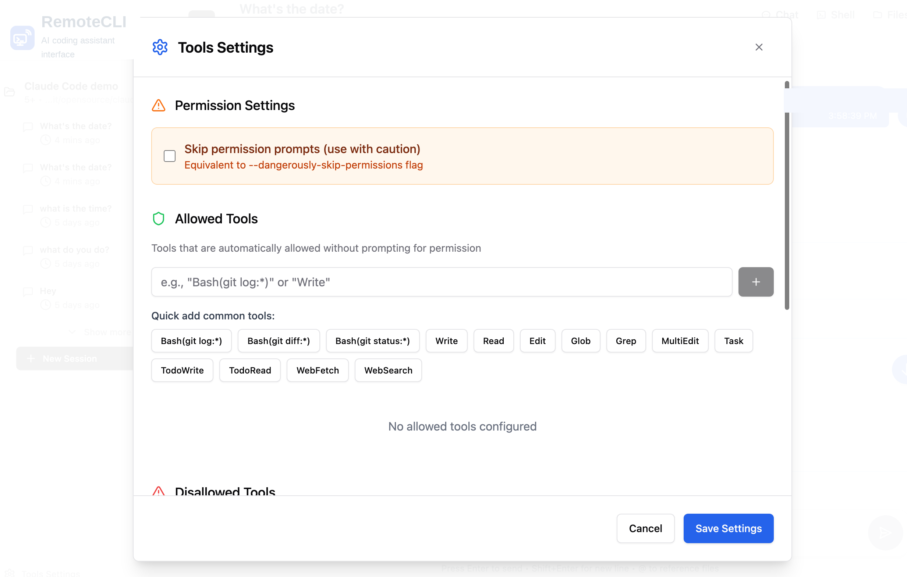

<div align="center">
  
  <h1>RemoteCLI</h1>
  <p><b>A modern web-based remote UI for Claude Code, Cursor CLI, and OpenAI Codex.</b><br>
  Access, manage, and collaborate with your coding agents from any device, anywhere.</p>

  <p>
    <a href="https://www.npmjs.com/package/@tunghuynh/remotecli"></a>
    <a href="https://www.npmjs.com/package/@tunghuynh/remotecli"></a>
    <a href="https://nodejs.org"></a>
    <a href="LICENSE"></a>
    
  </p>
</div>

---

## Overview

**RemoteCLI** provides an intuitive, responsive web interface for local AI coding CLI tools like [Claude Code](https://docs.anthropic.com/en/docs/claude-code), [Cursor CLI](https://docs.cursor.com/en/cli/overview), and [OpenAI Codex](https://developers.openai.com/codex).

Instead of being tethered to a single terminal window, RemoteCLI lets you monitor agent executions, edit files, inspect diffs, approve permissions, and run shell commands from any desktop browser, laptop, tablet, or mobile phone.

### ✨ Highlights

- ⚡ **Zero C++ Build Tools Needed**: Powered entirely by Node.js built-in `node:sqlite` and pure-JavaScript `bcryptjs`. No Visual Studio C++ Build Tools on Windows, no Xcode on macOS, and no `node-gyp` compilation errors.
- 🔄 **Direct CLI & Config Sync**: Reads and writes directly to your local configuration (`~/.claude`). Your existing projects, session history, and MCP tools are discovered automatically.
- 📱 **Mobile & PWA Ready**: Fully responsive mobile UI with touch navigation, virtual quick-keys, and iOS/Android home screen installation support.
- 🤖 **Multi-Agent Support**: Switch between Claude Code, Cursor CLI, and Codex within the same unified dashboard.
- 🔒 **100% Local & Private**: All data, sessions, and databases remain strictly on your own hardware. No external telemetry or cloud lock-in.

---

## Screenshots

<div align="center">

<table>
<tr>
<td align="center">
<h3>Desktop Interface</h3>

<br>
<em>Full workspace with project explorer, active sessions, interactive chat, and tool execution logs</em>
</td>
<td align="center">
<h3>Mobile Experience</h3>

<br>
<em>Responsive mobile design with touch controls, live diff views, and tool details</em>
</td>
</tr>
<tr>
<td align="center">
<h3>CLI & Model Selection</h3>

<br>
<em>Switch seamlessly between Claude Code, Cursor CLI, and Codex</em>
</td>
<td align="center">
<h3>Safe Tool Permission Controls</h3>

<br>
<em>Fine-grained control over allowed and disallowed agent tools</em>
</td>
</tr>
</table>

</div>

---

## Quick Start

### Run Instantly with npx

No installation required. Requires **Node.js >= 22.5.0**:

```bash
npx @tunghuynh/remotecli
```

### Global Installation (Recommended)

Install globally via npm for regular use:

```bash
npm install -g @tunghuynh/remotecli
```

Then start RemoteCLI anytime with:

```bash
remotecli
```

Open your browser at **`http://localhost:3001`**. All your active projects and existing agent sessions will be ready immediately.

---

## Access From Mobile or LAN

To use RemoteCLI from your smartphone, tablet, or another laptop on your local network:

1. Start RemoteCLI on your host machine:
   ```bash
   remotecli
   ```
2. Find your machine's local IP address (e.g. `192.168.1.50`).
3. Open `http://<YOUR_LOCAL_IP>:3001` in your mobile browser.
4. *(Optional)* Tap **"Add to Home Screen"** in Safari / Chrome for a standalone full-screen mobile app experience.

> **Tip:** You can also use secure mesh networks like [Tailscale](https://tailscale.com/) or WireGuard to access your coding agents remotely from anywhere outside your local network.

---

## CLI Commands & Options

```
RemoteCLI - Command Line Tool

Usage:
  remotecli [command] [options]

Commands:
  start            Start the RemoteCLI server (default)
  status           Show current configuration, paths, and database status
  update           Check and update RemoteCLI to the latest version
  version          Show installed package version
  help             Show CLI help and usage information
  sandbox          Manage Docker sandbox environments (experimental)
  browser-use-mcp  Run Browser MCP stdio server

Options:
  -p, --port <port>        Set server port (default: 3001)
  --database-path <path>   Set custom SQLite database path
  -h, --help               Show this help information
  -v, --version            Show version information
```

### Examples

```bash
# Start on default port 3001
remotecli

# Start on a custom port
remotecli --port 8080

# Inspect configuration and database storage location
remotecli status

# Update to latest version
remotecli update
```

### Environment Variables

| Variable | Description | Default |
|---|---|---|
| `SERVER_PORT` | Port the web server listens on | `3001` |
| `DATABASE_PATH` | Path to the SQLite storage database | `~/.remotecli/data.db` (or application root) |
| `CLAUDE_CLI_PATH` | Custom path to the Claude Code CLI binary | `claude` |
| `CONTEXT_WINDOW` | Fallback context window token limit | `160000` |

---

## Features

### 🤖 Multi-Agent Orchestration
Work with **Claude Code**, **Cursor CLI**, or **OpenAI Codex** within a single dashboard. RemoteCLI dynamically fetches available models at runtime, allowing you to choose the best model for your task.

### 💬 Interactive Chat & Diff Inspection
Real-time response streaming, syntax-highlighted code blocks, unified diff viewers, and collapsible tool executions give you complete transparency into what the agent is doing.

### 💻 Integrated Terminal (xterm.js)
Open full terminal sessions directly in the browser to run builds, test suites, or git operations alongside your agent conversations.

### 📁 File & Git Explorer
- **File Explorer**: Browse project directories, view file contents with syntax highlighting, and make quick edits.
- **Git Integration**: View modified files, inspect side-by-side diffs, stage files, switch branches, and commit changes.

### 🛡️ Safe by Default Tool Permissions
All agent tools (such as Bash, Write, Edit, Glob, Grep) can be inspected, allowed, or blocked through the **Tools Settings** modal. Prevent unintended destructive commands from running automatically.

### 🧩 Extensible Plugin System
Add custom tabs with their own frontend components and backend services. Install community plugins or develop custom extensions for task queues, session intelligence, or custom dashboards.

---

## System Requirements

- **Node.js**: `>= 22.5.0` (with built-in `node:sqlite` support)
- **Operating System**: Windows 10/11, macOS, or Linux
- **AI CLI**: At least one supported CLI installed on your machine:
  - [Claude Code](https://docs.anthropic.com/en/docs/claude-code): `npm install -g @anthropic-ai/claude-code`
  - [Cursor CLI](https://docs.cursor.com/en/cli/overview)
  - [Codex](https://developers.openai.com/codex)

---

## Security & Privacy

- **Local Execution**: RemoteCLI runs as a local web service on your machine.
- **Your Own Credentials**: RemoteCLI connects directly to your local CLI sessions; you use your own provider authentication.
- **Permission Safety**: Tool execution permissions match your security preferences and can be toggled per session or globally.

---

## License

This project is licensed under the [GNU Affero General Public License v3.0 or later (AGPL-3.0-or-later)](LICENSE).

Author: **Tùng Huỳnh** ([@tunghuynh](https://github.com/tunghuynh))
