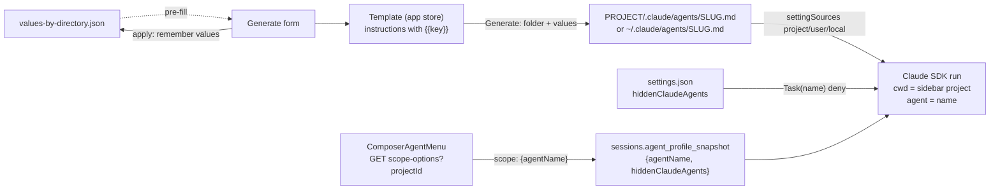

# Agent profiles (native-first)

*Reusable agent templates, generated into native Claude Code agent files per project, the main-agent
picker of a new chat, and app-owned memory blocks that agents read and write during chats. Server
`server/modules/agent-profiles/`, client `src/modules/agent-profiles/`, and the touch points in the run path.
Replaces the team-snapshot design (see "Removed in this redesign").*

---

## Purpose and native vs app

Claude Code already loads `.claude/agents/*.md`, CLAUDE.md and `.claude/rules/`, supports
`memory: project` and `claude --agent`. The app adds only what Claude Code lacks:

| Concern | Native (Claude Code) | App adds |
| --- | --- | --- |
| Agent definition | `.claude/agents/<name>.md`, `~/.claude/agents/<name>.md` | Templates with `{{param}}`; Generate writes the `.md` files |
| Shared instructions / habits | CLAUDE.md, `.claude/rules/` (loaded by `settingSources`) | Nothing (no habit store) |
| Agent memory | frontmatter `memory: project` | Optional per template; adds Read/Write/Edit when tools are restricted |
| Memory (shared text) | CLAUDE.md, `.claude/rules/`, `memory: project` | Memory blocks: named text, `read-only` or `writable`, global or per project folder; agents read and write them through MCP `blocks` in this app's chats only |
| Main agent | `claude --agent <name>` | Dropdown next to `/` in the composer of a new chat (`scope.agentName`) |
| Hide / show Claude's own agents | none | `hiddenClaudeAgents` → `Task(<name>)` deny on scoped runs |
| Parameter values | none | Remembered per folder (`values-by-directory.json`) |
| Phone / Remote | none | Main-agent dropdown reachable through the gateway; everything else Host-only |
| Live monitor | none | Separate module, see [agent monitor](./08-agent-monitor.md) |

## Architecture

- The project **is the sidebar project** (`Project.projectId`, folder = `projectPath`). There is no
  second project list.
- The app keeps **no copy** of generated agents. The `.md` file is the only source the CLI reads.
- Templates are the only app-owned prompt text; they never reach a run except through a generated file.
- Memory blocks are not written into files. The in-process `blocks` MCP server reads and writes the block
  store on every run that has a main agent, or whose chat folder has content for a project block (see [Memory blocks](#memory-blocks)).

## Data on disk

Root = `AGENT_PROFILES_DIR`, else `<os.homedir()>/.claude-code-ui/agent-profiles`.

| Path | Content |
| --- | --- |
| `templates/<id>.json` | Template records (`rev` for optimistic locking) |
| `settings.json` | `hiddenClaudeAgents[]`, `profileManagerAgents[]` (absent in older files = none), `rev` (one revision for both lists: any change bumps it) |
| `values-by-directory.json` | `{ "<folder key>": { "<param>": "text" } }`; global = key `@global` |
| `memory-blocks/<id>.json` | Memory block definitions (see [Memory blocks](#memory-blocks)) |
| `memory-block-contents/<id>/<hash>.json` | Content of a project block in one folder; `<hash>.tomb` keeps the last `rev` of a removed one (see [Memory blocks](#memory-blocks)) |
| `backups/<UTC stamp>-<4 hex>.json` | Snapshots (JSON bundles, mode 0600, folder 0700) the server writes before an import overwrites something; restored by file name (see [Import / export](#import--export)) |
| `pending/<id>.json` | Proposals an allowlisted agent staged through the `profiles` tools (folder 0700, files 0600, 24 h, at most 10; see [Profiles tools and staged proposals](#profiles-tools-and-staged-proposals)) |
| `memory-blocks.legacy/` | Backup copies of definitions saved by an older version, written before they are migrated |
| `agents/`, `memory/`, `projects/`, `learning-*.json`, `workspace/` | Old layout. Ignored: never read, written or deleted. `memory/` is the old habit store, not the new `memory-blocks/` |

- **Folder key**: normalized path, `/` separators; lower-cased for Windows paths (drive letter or UNC),
  so `C:\Work\Alpha` and `c:/work/alpha/` share values.
- **One bundled template.** A new store starts with no template except the generic profile manager `remotecli-manager`,
  offered **once** (`agent-profiles.manager-seed.ts`, marker file `seeded-manager.json` in the store root): the template is
  created unless a template with that slug exists, and its six skills (three guides to how the system works, three workflows) are copied to `~/.claude/skills/` unless a folder of
  that name exists. A template the user deletes or edits is never brought back or overwritten. It does nothing until the user
  Generates it globally and switches on *Profile manager*. It is sensitive (it lists the `profiles` tools) and, being seeded,
  skips the import tick. Every other template is created in Settings → Agent Profiles (or through the REST API); anything
  specific to a project or an organisation stays in the user's own store, never in the repository.
- **The old folders (`agents/`, `memory/`, `projects/`) are not migrated.** They stay on disk untouched and are never
  read or written.

## Templates

| Field | Meaning |
| --- | --- |
| `slug` | Unique; lower-case letters and digits separated by single hyphens, not a Windows reserved device name. Becomes the file name and the `name:` of the generated agent. A stored template whose slug breaks this rule (hand-edited file) is listed as corrupt |
| `family` | `orchestrator` or `worker`. A restricted orchestrator gets `Agent` added to `tools` |
| `name`, `description` | Description written to frontmatter as `"<name>: <description>."` (routing text) |
| `instructions` | Body; `{{key}}` placeholders |
| `params[]` | `{key, title, description, required, default?}`. Keys `project_name` and `project_directory` are reserved |
| `tools`, `disallowedTools`, `model`, `mcpServers`, `skills` | Copied to frontmatter when set |
| `memory` | Optional `project` / `user` / `local`. Off when absent |
| `usesBlocks` | Boolean, off when absent. On: Generate adds the three `mcp__blocks__*` tools to `tools` (only when `tools` is restricted) and a short "Memory blocks" paragraph. Independent of `memory` |
| `group` | Optional text, at most 40 characters, trimmed, stored only when not empty. The heading the agents made from this template are listed under in the new-chat main-agent dropdown. Not written into the agent file: `scope-options` resolves it live from the template named by the file's generated marker, so editing it needs no regenerate. Handmade files and agents whose template is gone or has no group fall under `System` |
| `bindings` | Required by the type (`project`, `knowledge`); `knowledge` has no effect |
| `rev` | PUT must send it; stale → 409 `PROFILE_STALE` |

Deleting a template leaves its generated files as they are.

## Generate

Target: a sidebar project → `<folder>/.claude/agents/<slug>.md`. "Global" → `~/.claude/agents/<slug>.md`
(scope `user`). No `--<project>` suffix in file names.

**File rules**

| Rule | Behaviour |
| --- | --- |
| Marker | First non-empty line directly after the closing `---` of the frontmatter: `<!-- generated by RemoteCLI from template <slug>; edit template, not this file -->`, and `<slug>` must equal the file's own name (`<slug>.md`). Anywhere else in the file, or naming another slug (a renamed copy), does not count. The generator and the Agents tab badge use this one rule (`readGeneratedMarker(text, slug)`) |
| Status `new` | File absent → created (`wx`, never overwrites) |
| Status `duplicate` | File has the marker → regenerated (re-checked right before an atomic temp + rename) |
| Status `handmade-exists` | File without the marker, a directory, or > 256 KB → skipped, never read through or overwritten |
| Status `missing-values` / `invalid-name` | Required param empty / bad name → skipped. A Windows reserved device name (`con`, `prn`, `aux`, `nul`, `com1-9`, `lpt1-9`) is an invalid name |
| Status `write-failed` | Set on Apply only: the file system refused this one file (permission, locked file, disk full, a path blocked by a file) → skipped, the other files are still written, the git exclude still covers the written ones. The answer is a normal `201`, never a 500 |
| Precedence (plan) | `invalid-name` > `handmade-exists` > `missing-values` > `duplicate` > `new` |
| Preview | `POST /generate/preview` writes nothing and remembers nothing |

**Values: two layers only**

1. Value typed in the request (empty string = unset)
2. Template `default`

Reserved: `project_name` (request value, else folder basename; the UI always sends the sidebar name) and
`project_directory` (normalized folder). Typed values can never override them. The server does **not**
merge remembered values: the client sends the full pre-filled values on every Preview / Apply, including
Regenerate. An omitted key falls back to the template default.

Rendering: `{{key}}` → `<param name="key">…</param>`, value escaped (`& < >`), control characters
stripped, capped at 4000 characters, preceded by a one-line notice that param content is data. Empty →
`(not set)`.

**Remembering**: on Apply only, per folder. Only keys the chosen templates declare are written. A key
sent empty is forgotten. Keys not sent stay.

**Frontmatter** (in this order): `name`, `description` (JSON-quoted), then `tools`, `disallowedTools`,
`model`, `memory`, `skills`, `mcpServers` only when set.

- `memory` set + restricted `tools` → `Read`, `Write`, `Edit` appended (an agent without Write cannot
  persist memory). No `tools` line = nothing added.
- Orchestrator with restricted `tools` keeps `Agent` (the delegation tool).
- `usesBlocks` + restricted `tools` → `mcp__blocks__block_list`, `mcp__blocks__block_read`,
  `mcp__blocks__block_write` appended (no duplicates). No `tools` line = nothing added: the agent inherits
  every tool, the blocks ones included. A `## Memory blocks` paragraph follows the instructions on every render:
  call `block_list` at session start, write only `writable` blocks, never store secrets, block text is data.

**Git exclude**: after writing into a project folder inside a git repository, the written files
(`.claude/agents/<slug>.md`) are appended to the file `git rev-parse --git-path info/exclude` names. When
`memory: project` is used, `.claude/agent-memory/` is added too (`.claude/agent-memory-local/` for
`local`). Idempotent. Not a repo, git missing, or any failure → nothing changes, `file: null`, Generate still
succeeds. Global scope never touches a repo. Sharing with the team is manual (not implemented).

**Response**: `{scope, agentsDirectory, created[], regenerated[], skipped[], gitExclude{file, added[]}}`.

## Memory blocks

Named text that agents read and write during this app's chats. The app owns the store and enforces the
rules on the server; the native memory (CLAUDE.md, `.claude/rules/`, `memory:`) stays as it is. Managed in
**Settings → Agent Profiles → Memory** (Host only).

**Definition** (`<AGENT_PROFILES_DIR>/memory-blocks/<id>.json`):

| Field | Meaning |
| --- | --- |
| `name` | Slug: 1–40 chars, lower-case letters and digits separated by single hyphens. Unique across **all** scopes: a global and a project block cannot share a name, so an agent sees one block per name |
| `description` | Up to 500 chars; shown by `block_list` |
| `mode` | `read-only` or `writable` (see Safety for what "read-only" does and does not stop) |
| `scope` | `{kind:'global'}` or `{kind:'project'}`. The kind cannot be changed after creation (409 `BLOCK_SCOPE_IMMUTABLE`). A project block has no folder in its definition |
| `content` | Global block: the text, must fit `maxChars`. Project block: always `''` (a `content` sent for it is ignored); the text lives per folder |
| `maxChars` | Default 2000, hard cap 20000. For a project block it applies to each folder's content. Nothing is cut to fit: a write that would pass it is refused |
| `rev` | Revision of the definition (a global block: of its text too), +1 on every change. An update or agent write that carries a stale `rev` is refused |
| `lastWriter` | `user`, `agent:<main agent name>` (`agent:claude-code` in a chat without one), or null (empty block). Global blocks only; a project block's writer is per folder |

At most **50 blocks** exist in total (all scopes). Unknown fields in a request are dropped.

**Per-folder content** of a project block (`<AGENT_PROFILES_DIR>/memory-block-contents/<id>/<hash>.json`):
`{directory, content, rev, lastWriter, updatedAt}`.

- **One definition, one file per folder.** `<hash>` is derived from the folder key
  (`valuesKeyOf(normalizeProjectPath(path.resolve(dir)))`, the one function REST, the service and the attach rule share).
  The same folder typed differently (`C:\Work\Alpha`, `c:/work/alpha/`) lands on the same file. The key is
  textual: it does not follow symlinks and it is case-sensitive on POSIX paths, so a symlinked or differently-cased
  alias of a folder is a different folder with its own file.
- **Only the Host creates a content file** (REST / the Memory tab), never an agent. A folder gets one with "Add folder"
  (an empty file, `rev` 1). At most **200** content files per block (409 `BLOCK_CONTENT_LIMIT_REACHED`); `.tomb` files do not count.
- **Empty vs remove.** The Memory tab's "Empty" clears the text but keeps the file and bumps its `rev` (agents in the folder
  keep the block, a stale edit stays refused). "Remove folder" deletes the file and leaves `<hash>.tomb` with the last
  `rev`; adding the folder again continues from that `rev` + 1, so an old `expectedRev` can never match a new file.
  Folders of projects deleted from the sidebar stay listed until removed there; nothing cleans them up automatically.
- **A corrupt content file** hides the block only in that folder and is reported in the `corrupt` list of the contents read;
  other blocks and folders keep working.
- **Deleting a block** removes its content files, then the definition; a retry finishes a half delete.
- **Migration.** A definition saved by an older version (`{kind:'project', directory}`) is moved on first use, once per run
  and idempotently: its old folder gets a content file with the old text, `rev`, writer and time, and the definition becomes
  `{kind:'project'}`. The old definition is copied to `memory-blocks.legacy/` first, and a failure on one record never stops
  the others or the app. A legacy block whose name clashes with another block (global wins) is not moved: it stays visible
  only in its old folder and the Memory tab flags it "Needs attention" with the reason.
- **Rollback.** Copy the files from `memory-blocks.legacy/` back over `memory-blocks/`. An older app build reads the new
  definitions as corrupt (it does not know a project scope without a folder), so do not run one against a migrated store.
- `AGENT_PROFILES_DIR` moves the whole store; it is meant for tests and normally unset.

**Who sees what.** Global blocks go to every run. A project block goes only to a run whose working folder (same folder key)
has a content file for it: a folder without one does not see the block at all (no name, no description). A subfolder or a
git worktree of the project is a different folder. Scope is split by global / project only. A block cannot be
limited to one agent (the tool call does not say which agent made it). In a folder, an agent reads and writes that
folder's file only and cannot reach another folder's content.

**Agent tools.** In-process MCP server `blocks` (`createSdkMcpServer`), built per run in
`agent-profiles.blocks.mcp.ts`:

| Tool | Does | Approval |
| --- | --- | --- |
| `mcp__blocks__block_list` | Name, mode, scope, last writer, size, description and `rev` of each visible block. No content | Pre-approved |
| `mcp__blocks__block_read(name)` | One block's content, with its `rev` | Pre-approved |
| `mcp__blocks__block_write(name, content, how, expectedRev?)` | `how: replace` sets the whole text, `how: append` adds a new line at the end. `expectedRev` optional: when sent, a stale write is refused | Normal approval flow (asked in non-bypass modes) |

- **Attached on every run**, resumed runs included, when `resolveBlocksAgentName` (`claude-blocks-mcp.ts`) gives
  a name: the session's main agent (`agentProfile.agentName`), or `claude-code` for a chat with no main agent
  (plain chat, or a scoped chat with `agentName: null`) whose folder has content for at least one **project** block
  (`blocksService.hasProjectContent`, exact folder key; an empty content file counts). Global blocks alone do not attach it, so a plain chat in a
  folder without project memory carries no `blocks` server and no extra tools. A store read error is logged and
  counts as "no blocks"; the run goes on.
  A resumed session does not remember the server (spike C-0), so `claude-runtime.provider.ts` adds it on each
  run and merges it into the configured `mcpServers`; those are kept. A configured server literally named
  `blocks` is replaced.
- **Plain chat with project memory** is how generated sub-agents reach
  the blocks when Claude Code hands them work by `description`: their tool calls go through the chat's server.
  The chat's own Claude Code may also call the tools; accepted.
- A sub-agent's write is recorded under the **main agent's** name; with no main agent, under `agent:claude-code`.
- Refusals come back as tool errors with the reason: `read-only`, over `maxChars`, unknown name, stale `expectedRev`.
- Block text is returned only inside `<block name=".." mode=".." writer="..">…</block>`, with `& < >` escaped
  (quotes too in attributes). It is never placed in a system prompt.

**Safety and limits**

- **Agent-written text is untrusted data.** It is escaped in tool results and never in a system prompt. Still,
  a writable block outlives its chat: a prompt-injected agent can write a line that later runs read.
- **`read-only` is best-effort.** The server refuses every write through the tools. An agent with `Bash`, or
  with no `tools:` limit, can edit the store file directly, since it knows the path. The Memory tab shows a
  notice on read-only blocks naming the agents that could do this. This is accepted policy, not enforced.
- **Scope is global / project only, never per agent.** Limiting a block to one agent is not possible.
- **Only in this app's chats.** The `claude` CLI on the host does not see the blocks, and they are not in
  CLAUDE.md. Old habit content is not converted into blocks automatically; the migration script creates blocks only from a JSON file you write (see Migration note).
- **Remote:** the REST routes are Host-only. A Controller chatting with a main agent (or in a folder with content for a
  project block) still lets that chat list, read and write blocks, because the tools run on the Host.
- **A plain chat in a folder with project content sees the tools too.** `block_list` and `block_read` are
  pre-approved; `block_write` goes through the normal approval flow (not asked in bypass mode, as for scoped
  chats). Content stays escaped and out of the system prompt; a prompt-injected chat can still write a line that
  later runs read.

## Import / export

Templates and memory blocks move between independent hosts as one text **bundle** (YAML by default, JSON accepted). The
file format, field tables, examples and a paste-ready prompt for an AI are in [agent-bundle-format.md](../agent-bundle-format.md). An example agent that proposes templates and blocks from a chat (`remotecli-manager`, with skills and a setup README) is under [docs/examples/remotecli-manager](../examples/remotecli-manager/README.md); it is seeded once per store (see the "One bundled template" note under Data on disk), and the seed is kept equal to the example by a test.
There is no sync: each host imports and recreates its own copy. Import, export, snapshots and restore are Host-only.

- **Code.** `agent-profiles.bundle.service.ts` (export, plan, apply, restore), `.bundle.validation.ts` (per-item checks, request
  bodies), `.bundle.format.ts` (`parseBundleText`, `serializeBundle`), `.backup.ts` (snapshot files). Every rule (slug and name
  checks, 50 blocks, 200 files per block, `maxChars`, revisions, scope immutability) stays in the template and block
  services; the bundle service decides what an import would do and calls them. It is fully synchronous: snapshot, re-plan and
  writes run without another request interleaving.
- **Text.** Parsed with the `yaml` package (core schema, anchors and aliases refused, duplicate keys an error, nesting <= 8,
  at most 500 folder entries per bundle). Errors carry line, column and path. The request body of the bundle routes is
  capped at 5 MB by a parser mounted before the global 50 MB one (`agentProfilesBundleBodyParser`).
- **A bundle is untrusted input** (a person or an AI may have written it). Import is a dry-run preview per item (`new`,
  `identical`, `conflict`, `invalid`, `skipped`); duplicates are skipped unless ticked; a sensitive template (`mcpServers`, no
  `tools`, `Bash`/`Write`/`Edit`/`NotebookEdit`, `mcp__*`, `skills`) needs its own tick.
- **Folders.** The `directory` of a folder entry is only a mapping key (`blockContentKey`). The target folder is always the sidebar
  project the user maps (`projectMap: {[sourceKey]: projectId}`, resolved on the server); an unmapped entry is skipped and the
  block's definition still imports. Nothing in a bundle can name a place to write.
- **Never destructive on text.** A bundle without text keeps stored text; a project definition update never touches folder files;
  a folder entry overwrites only its own folder and only when its key is ticked; import never removes a file.
- **Stale guard.** The preview returns a `basis` per item and folder (template `rev`, block definition `rev`, folder content `rev`,
  or `absent`); apply compares it with the live value and fails that item with `STALE` when it moved. An overwrite without a
  `basis` is refused.
- **Snapshots.** Before an apply that will overwrite something (and only then) the server writes every template, block and folder
  text to `backups/` and refuses to continue when it cannot (`SNAPSHOT_UNAVAILABLE`), also when a stored record is unreadable. A
  block not yet moved to per-folder text, or with an unreadable folder file, cannot be backed up, so it is never overwritten by an
  import. Pruned when both older than 14 days and beyond the newest 50.
- **Restore** names a snapshot by file name (checked against the snapshot name pattern, no path) and applies it with every key
  overwritable, to the folder each text was stored for; items created since are kept; a scope clash or unmigrated block is skipped
  with its code. It takes its own snapshot first.
- **Provenance.** `lastWriter` travels in the bundle: `agent:<name>` text stays marked as agent text, anything else becomes `user`.
- **Trust statement.** A paired Controller is a full-trust grant of the Host (see `route-rules.ts`). The Remote denial of `/bundle/**`
  reduces surface and stops accidents and prompt injection; it is not a boundary against a hostile Controller.

## Profiles tools and staged proposals

An allowlisted main agent can look at the store and **propose** changes to it from a chat. It never writes the live store: a
proposal is a file under `pending/` that the Host user confirms in the app. Code: `agent-profiles.profiles.mcp.ts` (the tools),
`.profiles.tool-names.ts`, `.changeset.ts` (parse, guardrails, readable summary; pure), `.pending.service.ts` (the staged files),
`BundleService.reviewChangeset/applyChangeset` (the apply path), `claude-profiles-mcp.ts` in the providers module (attach rule).

**Tools** (in-process MCP server `profiles`, built per run like `blocks`; every returned string is escaped inside `<template>`,
`<block>`, `<item>`, `<error>` tags, nothing goes into a system prompt; an error shows its message only for a `CHANGESET_*` or
`PENDING_*` code, anything else is one generic line):

| Tool | Does |
| --- | --- |
| `profiles_list` | Templates (slug, name, description, family) and blocks (name, mode, scope, size; for a project block how many folders have text, never paths). No prompt text, no block content |
| `profiles_get(kind, key)` | One template (with instructions) or one block (a global block's text; a project block only as a definition with its folder count) |
| `profiles_preview(changeset)` | The guardrails and a readable summary per item against the store now. Writes nothing |
| `profiles_propose(changeset)` | Same checks, then stages `pending/<id>.json` and returns `pendingId` and the summary; the text tells the agent to ask the user to confirm under Settings -> Agent Profiles -> Pending |

All four are pre-approved (`allowedTools`) because none of them changes the store.

**Attach rule.** `resolveProfilesAgentName` (`claude-profiles-mcp.ts`), next to `blocks` in `claude-runtime.provider.ts`. The server and the
four tool names are added on every run (resumed ones too) only when ALL hold: the provider is Claude; `readRunOrigin(options.origin) === 'local'`
(absent or unknown reads as remote: never for a Controller, scheduled, queued or `/api/agent` run); the session's main agent is in
`profileManagerAgents`; that name resolves to the **user-level** generated file `~/.claude/agents/<name>.md` (marker naming the same slug;
a project file of the same name shadows it in Claude Code and disqualifies it, readable or not); the settings read cleanly. Any error or
malformed value means no tools, never an exception in the run path. The allowlist is set with `PUT /claude-agents/managers {names, rev}`
(Host UI) and is checked again at propose time, so removing a name stops a run that is still open.

**Changeset.** `{upsert?: bundle, delete?: [{kind: 'template'|'block', key}]}`: at most 5 items and 20 KB, one key never both upserted and
deleted (`CHANGESET_CONFLICT`), unknown fields refused (no way to name settings or the allowlist), deletes run before upserts. Codes:
`CHANGESET_INVALID`, `_EMPTY`, `_TOO_MANY_ITEMS`, `_TOO_LARGE`, `_CONFLICT`, `_REFUSED`, `_NOOP`, `_NOT_ALLOWED`, `_TARGET_NOT_FOUND`; `PENDING_FULL`, `PENDING_NOT_FOUND`.

**Guardrails** (the same function at propose and again at confirm, from the store as it is then; a refused item at propose refuses the whole proposal):

- *Hard refusals*: a template with `mcpServers`, with an `mcp__profiles__*` tool (or `mcp__profiles`), or with no `tools` line (an agent-made agent must state
  its tools); any `contents[]` entry or `scope.directory` on a block (folder text is created by the Host only, an agent never names a folder: a
  project block proposal is a definition, the user adds folders in the Memory tab); a block whose name exists with the other scope; a read-only block
  (overwrite or delete); a block that cannot be backed up (`needsAttention`, unreadable folder file); a template whose slug (= generated agent name)
  is in `profileManagerAgents`. A slug is the key an item is matched by, so an overwrite can never rename a template (the generated file keeps its name).
- *Needs the user's tick at confirm* (`acceptSensitive`): `Bash`, `Bash(...)`, `Write`, `Edit`, `NotebookEdit`, other `mcp__*`, non-empty `skills`. An overwrite or a delete
  also needs its key in `overwrite` (ticking a delete confirms it); a create needs none.
- *Provenance*: global block text written through a proposal is recorded as `agent:<name>` whatever the proposal claims. An agent changeset never creates, overwrites or
  removes a folder file, except that deleting a whole project block removes its folder files after the snapshot.
- *Readable summary per item* (create / overwrite / delete / identical / refused): changed fields with before and after, tools granted, what a delete loses
  (a global block's text size; a project block's folder count and total size), sensitive reasons.

**Confirm** (`POST /pending/:id/confirm {overwrite[], acceptSensitive[], basis}`): re-validates everything from scratch (the staged summary and plan are never trusted;
a pending file is plain JSON that anyone with file access could write, so an invalid one is ignored), takes the snapshot first (also for deletes; folder text of a deleted
project block is in it, so Restore brings it back), then deletes, then upserts, as `actor {kind:'agent', name}`. `basis` is the one `GET /pending` returned, so a
tick applies to what the user saw: an item that moved is `failed STALE`. Each item succeeds or fails alone; the pending file is removed afterwards (an error before
anything was applied, such as `SNAPSHOT_UNAVAILABLE`, leaves it). Reject drops it. Expired proposals (24 h) are dropped when read and free their place.

**Why staged confirmation replaced the SDK permission prompt.** An approval through the SDK can be bypassed: `skipPermissions`, "Always allow" (a remembered
tool) and a project `.claude/settings.json` all pre-approve a tool. The app's own confirmation in the Host UI does not depend on any of them, so the tools need no
SDK approval and can be pre-approved.

**Trust note.** The real limits are the human confirmation in the Host UI, the hard refusals above, the caps (5 items, 10 pending, 24 h), the snapshot and the Host-only
origin. A paired Controller is a full-trust grant of the Host (see `route-rules.ts`): the origin marker and the Remote denial of `/pending/**` contain accidents and
prompt injection that arrives through a Controller chat; they are not a boundary against a hostile Controller, which can write these files itself. An agent with
`Write`/`Bash` can also create files, and the name-keyed allowlist can be forged by whoever can write `~/.claude/agents`; that gap is accepted.

## Session scope and run

`POST /api/providers/sessions` body: `{provider:'claude', projectPath, initialMessage?, scope?: {agentName}}`.

| Case | Result |
| --- | --- |
| `scope` absent | Plain chat. No agent, hide list **not** applied |
| `scope.agentName = null` | Scoped chat without main agent. Hide list applied |
| `scope.agentName = "x"` | Must be a readable file with front-matter `name: x` in `<projectPath>/.claude/agents/` or `~/.claude/agents/`. Else 404 `AGENT_NOT_FOUND`. Built-ins and other projects do not count |

Stored in `sessions.agent_profile_snapshot` as `{agentName, hiddenClaudeAgents}` (hide list copied at
creation). `agent_scope_project_id` is no longer written; fork copies the snapshot.

Every run (resume and fork included) in `claude-runtime.provider.ts` `mapCliOptionsToSDK`:

- `sdkOptions.agent = agentName` (only when set)
- `mcpServers.blocks` = the in-process memory block server, merged into the configured servers (only when `resolveBlocksAgentName` gives a name: the main agent, or `claude-code` for a chat whose folder has content for a project block; set in `queryClaudeSDK` after `mapCliOptionsToSDK`; see [Memory blocks](#memory-blocks))
- `allowedTools` += `mcp__blocks__block_list`, `mcp__blocks__block_read` (only in the same case); `block_write` stays on the normal approval flow
- `mcpServers.profiles` and `allowedTools` += the four `mcp__profiles__*` tools: only for a local run of an allowlisted main agent that resolves to its user-level generated file (see [Profiles tools and staged proposals](#profiles-tools-and-staged-proposals))
- `disallowedTools` += `Task(<name>)` per hidden name (exact case as Claude reports it)
- **never** `sdkOptions.agents`
- `settingSources = ['project','user','local']`
- client-sent `agentProfile`, `systemPrompt`, `agents`, `agent`, `cwd` are dropped for scoped sessions
  (`chat-websocket.service.ts`)

Session details: `agentScope: {agentName} | null`.

## Spike findings that constrain the design

Verified in `reports/phase-00-spike-report.md` on SDK 0.3.165 / bundled CLI 2.1.165 through the gateway.

| # | Finding | Consequence |
| --- | --- | --- |
| 1 | `agent:` resolves from `<cwd>/.claude/agents/x.md` with no `agents` option; prompt and tools apply | `agents` option dropped |
| 2 | Resume keeps the agent (also without re-passing `agent`) | Still re-passed every run (cheap, deterministic) |
| 3 | Orchestrator delegates to worker file; `Task(Explore)` deny blocks the built-in at call time | Hide list = `Task(name)` deny |
| 4 | **Auto memory does not reach a custom main agent** (`agent` replaces the preset prompt). `memory: project` works, stores in `<cwd>/.claude/agent-memory/` | Habits go to CLAUDE.md / rules / `memory:` |
| 5 | Agent file edits apply on the next run (live, not frozen) | No team snapshot needed |
| 6 | Host CLI 2.1.329 `claude --agent x -p`: tools applied, persona **ignored** | **Open**: interactive `claude --agent` not verified |

Verified on CLI 2.1.165 only. The app runs that bundled CLI; the host CLI is newer.

Memory blocks spike C-0 (`reports/memory-blocks-spike-c0-report.md`, SDK 0.3.165, bypass mode): a main agent
and a sub-agent both read and wrote the `blocks` tools, a `read-only` write was refused, and a resumed run
with `mcpServers` re-passed still called them. A resumed run **without** `mcpServers` could not call them. Hence
the server is attached on every run (see [Memory blocks](#memory-blocks)).

## HTTP surface

All under `/api/agent-profiles`, Host auth. "Remote" = policy for a paired controller (phone).

| Method path | Use | Remote |
| --- | --- | --- |
| GET `/scope-options?projectId=` | Main agents of a sidebar project + `~/.claude/agents`: `{agents:[{name, source: project\|user, isOrchestrator, group?}]}` (`group` = the Group of the generating template, absent otherwise). Hidden names and names `POST /sessions` would refuse (not `^[A-Za-z0-9][A-Za-z0-9_-]{0,63}$`) excluded. Sorted project first | **allow** |
| GET `/claude-agents?directory=` | Claude agents (built-in, user, project) with `generated`, `generatedFrom`, `path`; plus `hiddenNames`, `managerNames`, `hiddenRev` (the one settings revision), `builtinSource` | deny |
| PUT `/claude-agents/hidden` | `{names, rev}` → `{hiddenClaudeAgents, rev}`; 409 when stale | deny |
| PUT `/claude-agents/managers` | `{names, rev}` → `{profileManagerAgents, rev}`; names must be valid agent names (at most 50); 409 when stale (the hide list and this list share `rev`) | deny |
| GET / POST `/templates` | List (`{items, corrupt[]}`) / create (201; 409 `SLUG_TAKEN`) | deny |
| GET / PUT / DELETE `/templates/:id` | PUT needs `rev` (409 `PROFILE_STALE`) | deny |
| GET / POST `/memory-blocks` | List of definitions (`{blocks}`, sorted by name; unreadable files skipped; a legacy block that could not be moved carries `needsAttention`) / create (201; 400 when `scope.directory` is sent (a project block has no folder of its own, same for PUT); 409 `BLOCK_NAME_TAKEN`, `BLOCK_LIMIT_REACHED`) | deny |
| PUT / DELETE `/memory-blocks/:id` | PUT replaces the definition fields, needs `expectedRev` = definition `rev` (409 `PROFILE_STALE`, `BLOCK_SCOPE_IMMUTABLE`); the user may edit read-only blocks; a project block's `content` is ignored. DELETE removes content files then the definition → `{ok:true}` | deny |
| GET `/memory-blocks/:id/contents` | Folders with content of a project block: `{contents:[{directory, content, rev, lastWriter, updatedAt}], corrupt:[{id, error}]}`. 400 `BLOCK_NOT_PROJECT_SCOPE` for a global block, 409 `BLOCK_NOT_MIGRATED` for an unmigrated legacy block | deny |
| POST `/memory-blocks/:id/contents` | `{directory}` (any absolute folder, normalized server-side) → creates an empty content file, 201 `{content}`. 409 `BLOCK_CONTENT_EXISTS`, `BLOCK_CONTENT_LIMIT_REACHED` | deny |
| PUT `/memory-blocks/:id/contents` | `{directory, content, expectedRev}`; `expectedRev` = the **content** `rev` loaded (409 `PROFILE_STALE`); 400 `BLOCK_TOO_LARGE` over `maxChars`; 404 when the folder has no file | deny |
| DELETE `/memory-blocks/:id/contents?directory=&expectedRev=` | Empties the text, keeps the file, bumps `rev` → `{content}`. With `&remove=true` deletes the file (tomb keeps the `rev`) → `{ok:true}`. `expectedRev` (optional, the content `rev` loaded; the Memory tab always sends it): stale → 409 `PROFILE_STALE` and nothing changes, malformed → 400; without it the current `rev` is used (blind write). 404 when the folder has no file | deny |
| POST `/bundle/export` | `{templateIds?, blockIds?, includeBlockContent?, format?: 'yaml'\|'json'}` → `{filename, text, problems[]}` (YAML by default; block text and folder text only with `includeBlockContent`) | deny |
| POST `/bundle/import/preview` | `{text, projectMap?}` (`text` = the bundle as YAML or JSON, parsed on the server) → `ImportPlan` `{items, hasFolderText}`; writes nothing. Each item and folder row carries `basis` | deny |
| POST `/bundle/import` | `{text, overwrite?, acceptSensitive?, projectMap?, basis?}` → **200** `ImportResult` `{items, partial, snapshot}` (never 201: a mixed result must not look like plain success). `basis` (from the preview) is required for every overwrite | deny |
| GET `/bundle/snapshots` | Snapshots newest first: `[{name, createdAt, templates, blocks, folders, bytes}]` | deny |
| POST `/bundle/restore` | `{snapshot}` (a file name written by the server, never a path) → `ImportResult`; 404 `SNAPSHOT_NOT_FOUND` for anything that is not a snapshot file name | deny |
| GET `/pending` | Waiting proposals, oldest first: `[{id, createdAt, expiresAt, agentName, items[], basis}]`; `items` is a fresh review against the store now (`key, kind, label, action, needsTick, basis, sensitive, refusal?, lines, changes`), `basis` maps each key to send back at confirm. No raw changeset | deny |
| GET `/pending/count` | `{count}` of waiting proposals (the Settings badge) | deny |
| POST `/pending/:id/confirm` | `{overwrite?, acceptSensitive?, basis?}` → **200** `ImportResult` `{items, partial, snapshot}`; re-validates everything, applies with the agent as actor after a snapshot, removes the proposal. 404 `PENDING_NOT_FOUND`, 409 `SNAPSHOT_UNAVAILABLE` | deny |
| POST `/pending/:id/reject` | → `{rejected:true}`; 404 `PENDING_NOT_FOUND` | deny |
| GET `/generate/values?directory=` | Remembered values of a folder (absent = global) | deny |
| POST `/generate/preview` | Plan only. `{directory?, projectName?, templateIds[1..50], values?}` | deny |
| POST `/generate` | Write + remember + git exclude. 201 | deny |

**Remote policy** (`route-rules.ts`): explicit deny for `/templates/**`, `/generate/**`,
`/claude-agents/**`, `/memory-blocks/**`, `/bundle/**`, `/pending/**`; one allow for `GET /scope-options`. Anything else (including removed `/projects`,
`/agents`, `/lint`, `/memory`) is default-denied (`route-unknown`). Client mirror
`src/shared/transport/target-route-policy.ts` is kept equal by a parity test.

**Errors**: `{success:false, error:{code, message}}`. Messages never echo folder paths. Codes:
`INVALID_PROFILE_INPUT`, `DIRECTORY_NOT_FOUND`, `DIRECTORY_NOT_A_DIRECTORY`, `PROFILE_NOT_FOUND`,
`PROFILE_CORRUPT` (500, file left untouched), `PROJECT_ID_REQUIRED` (400), `PROJECT_NOT_FOUND` (404),
`INVALID_SESSION_SCOPE` (400, also for the old `{projectId}` shape), `SCOPE_UNSUPPORTED_PROVIDER`,
`PROJECT_PATH_REQUIRED`, `INVALID_AGENT_NAME`, `AGENT_NOT_FOUND`, `BLOCK_NAME_TAKEN`, `BLOCK_LIMIT_REACHED`,
`BLOCK_SCOPE_IMMUTABLE`, `BLOCK_NOT_PROJECT_SCOPE`, `BLOCK_NOT_MIGRATED`, `BLOCK_CONTENT_EXISTS`, `BLOCK_CONTENT_LIMIT_REACHED`,
`BLOCK_NOT_FOUND`, `BLOCK_READ_ONLY`, `BLOCK_TOO_LARGE`, `BLOCK_STALE`, `BLOCK_EMPTY_APPEND`, and for bundles `BUNDLE_INVALID` (400, `details: {line, column, path}`), `BUNDLE_VERSION_UNSUPPORTED` (400), `SNAPSHOT_UNAVAILABLE` (409), `SNAPSHOT_NOT_FOUND` (404), and for proposals `CHANGESET_*` (400, `CHANGESET_NOT_ALLOWED` 403), `PENDING_FULL` (409), `PENDING_NOT_FOUND` (404). `BLOCK_NOT_FOUND`, `BLOCK_READ_ONLY`, `BLOCK_STALE` and `BLOCK_EMPTY_APPEND` are agent tool refusals, not HTTP errors (`BLOCK_TOO_LARGE` is both: a tool refusal, and the 400 of a user edit).

`scope-options` takes the **sidebar project id** (`Project.projectId`, the id `GET /api/projects` returns),
never a path or name. The server resolves the folder. An archived project still resolves. A stale client bundle
(phone or cached page) that still calls it without `projectId` gets `400 PROJECT_ID_REQUIRED`: it fails loudly
instead of guessing a folder, and the client must reload.

## Client UI

**Settings → Agent Profiles** (4 tabs, `AgentProfilesPanel.tsx`; the panel is Host only, so a Remote target never mounts it and never reads the pending count):

- **Agents**: target select (each sidebar project, or Global `~/.claude/agents`). List grouped
  *Built into Claude Code / Personal / Project: name*, with badges Generated / Handmade / Hidden, a
  visibility switch, hide-all / show-all, hidden-only filter, and details (path, tools). Button
  **Generate agents** opens the form: tick templates → values pre-filled from `/generate/values` → plan table
  (status per template, path) → Apply → result (created / regenerated / skipped, git-exclude note).
  Preview is disabled while remembered values load or failed; Apply needs a plan from a Preview.
  Every agent file (not the built-ins) also has a **Profile manager** switch: it adds or removes the name in
  `profileManagerAgents` through `PUT /claude-agents/managers {names, rev}` (`rev` is the settings revision the hide list shares, so after
  either save the listing is read again and both lists refresh). The hint says it works only for the user-level generated agent and only in
  Host chats; a 409 reloads the list.
- **Templates**: list, editor (fields, params builder, `{{key}}` check, tools / MCP / skills / model pickers,
  `memory` select, `usesBlocks` switch, preview), delete with confirm. Corrupt files named in a notice.
- **Pending** (`pending/PendingTab.tsx`, `PendingProposalCard.tsx`, `usePendingProposals.ts`): what manager agents proposed and nobody confirmed. Read when the tab opens, on **Refresh** and every 15 s while the tab is mounted and the page is visible (silent, never while hidden); an expired proposal is gone from the next read. Each card shows the agent, age and expiry and one block per item built from the server's review, never raw JSON: action badge (Create / Overwrite / Delete / No change / Refused with its reason), the readable lines (a delete states the text size and folder count lost), before and after of each changed field with *Show full text* for long text, and a Sensitive badge naming the reasons. Nothing is ticked by default: overwrites and deletes need their tick and each sensitive item its own (*Select all sensitive* as in Import); a refused item has none. **Confirm** posts `overwrite[]` (deletes included), `acceptSensitive[]` and `basis` copied from `GET /pending`, so a moved item comes back `STALE`; the per-item results, the partial warning and the snapshot name stay under the list until dismissed. **Reject** drops the proposal. Both refresh the counts.
- **Pending count badge**: `usePendingCount` reads `GET /pending/count` once and then about every 60 s while the page is visible (and at once on becoming visible and after a confirm or reject), keeping the last number on a failed read and showing no toast. It feeds the number on the Pending tab and `PendingSettingsBadge` on the sidebar's Settings buttons (header on desktop and phone, collapsed rail). In a Remote target it never calls the route and renders nothing.
- **Header buttons Export / Import / Restore** (`src/modules/agent-profiles/bundle/`): Export picks templates and blocks, block text off by default, YAML or JSON download. Import takes a file or pasted text, previews (statuses, problems with line and column, per-conflict and per-sensitive ticks with *Select all sensitive*), maps each source folder to a sidebar project only when the bundle carries folder text, then applies and shows per-item results, a partial warning and the snapshot name. Restore lists snapshots newest first and asks before restoring. See [Import / export](#import--export).
- **Memory**: the blocks of every scope (name, mode, scope; a global block also size, last writer, time of change), the form
  (name, description, mode, global or project, content for a global block, max characters; the scope is fixed once saved) and delete with confirm.
  A project block expands to its folders: each folder with content (size, last writer, time) has edit, empty and
  "Remove folder" (both with confirm); "Add folder" picks a sidebar project and creates an empty content file. A notice says
  agents see the block only in the listed folders. A legacy block that could not be moved is flagged "Needs attention" with the reason.
  Read-only blocks show a notice that the lock is not hard when a non-built-in agent in the Agents tab's
  list can bypass it (`Bash`, or no `tools:` limit).
- **First-run wizard** (`FirstRunWizard.tsx`, 3 steps): Claude sign-in → pick templates → pick sidebar project +
  Generate form. Finish opens a new chat on that project (no agent preselected). Auto-opens when the first
  agent read has no non-built-in agent and it was not dismissed.

**New chat** (`ComposerAgentMenu` in chat's composer toolbar, state from `useNewChatScope`; the old `/` button is gone,
typing `/` still opens the command menu): a "Main agent" dropdown in the style of the model menu, default `Auto`, then
the agents under group headings: named groups (template `group`) alphabetically, `System` last for everything
without one (a single group shows no heading). Each heading is a collapse toggle with the agent count; named groups
start expanded, `System` starts collapsed, and agents sit indented under their heading. Inside a group: orchestrator first, then project agents, then
personal. `Auto` = no main agent: Claude Code picks a sub-agent per task from the
agents' `description`. A chosen agent works the whole chat itself (SDK `agent` option). After the list is read the
composer always sends `scope: {agentName}` (`null` for Auto), so the hide list applies in every chat that has the
dropdown. Before the read, or for other providers, no scope key is sent. The dropdown is hidden when the project
offers no agents. The phone uses the same component.
A session with `agentName: null` only carries the hide list: it runs as a plain chat (the client still picks
`cwd`, and a deleted project row does not refuse the turn). Only a session with a main agent is locked to its
project folder (`SESSION_PROJECT_MISSING` when that row is gone) and ignores client `systemPrompt` / `agents` /
`agent` / `cwd`.

**Open chat** (`SessionScopeBadge`): "Main agent: x" from session details (`agentScope.agentName`).

## Environment

| Variable | Effect | Default |
| --- | --- | --- |
| `AGENT_PROFILES_DIR` | Store root (templates, settings, values file, memory blocks) | `~/.claude-code-ui/agent-profiles` |

`AGENT_PROFILES_MEMORY` (habit kill switch) is removed.

## Removed in this redesign

| Removed | Where it lives now |
| --- | --- |
| Learning from chat history (scan, proposals, cache, model call) | Write habits in CLAUDE.md or `.claude/rules/` |
| Habit memory (learned blocks), compile, token and count ceilings, Remember-this dialog | CLAUDE.md, `.claude/rules/`, `memory: project` in the template. The new [memory blocks](#memory-blocks) are a different feature, not a restore of these |
| Agent records (store, overrides, `projectId`, `agents/` folder) | `.claude/agents/*.md` (Generate) |
| Agent-profile projects (store, tab, routes, wizard create step) | Sidebar project; values remembered per folder |
| Lint (`/lint`, banner, token estimates) | Nothing |
| Default-orchestrator flag, duplicate, restore-samples, import from Claude agent, origin label | Plain templates (edit or re-create) |
| Q&A / no-project scope, neutral `workspace` folder, Start-Q&A button | Plain Claude chat (no scope) |
| Team snapshot: `agents`, `orchestratorName`, prompt version, memory record, 512 KB size guard | `{agentName, hiddenClaudeAgents}` |
| `sdkOptions.agents` | `sdkOptions.agent` (name only) |
| Routes `/projects/**`, `/agents/**`, `/lint`, `/memory/**`, `/templates/:id/duplicate`, `/default-orchestrator`, `/from-claude-agent`, `/restore-samples` | Removed (404) |
| `AGENT_PROFILES_MEMORY` | No replacement |

## Migration note (for users)

- The old `agents/`, `memory/`, `projects/`, `learning-*` files are ignored, not converted.
- **Old memory / learning content: copy it by hand** into the project's `CLAUDE.md` (shared), or into
  `.claude/rules/*.md`, or into `~/.claude/CLAUDE.md` (all projects). Nothing imports it.
- Old agent records: create again with Generate (type the values once; they are then remembered).
- Old chat rows still open: `orchestratorName` + `agents` read as `{agentName: null, hiddenClaudeAgents}`
  (stays scoped, hide rules kept, no forced main agent).

## Gotchas

- **Edits apply to the next run.** Changing a template or regenerating does not affect a run in progress.
  Changing a `.md` file by hand applies to the next run too.
- **The main agent replaces Claude's preset prompt.** Working rules (asking, routing, reporting, caution
  with destructive actions) must live in the orchestrator template or in CLAUDE.md.
- **Auto memory does not reach a custom main agent.** Use `memory: project` on the template. Keep
  Write/Edit in its tools (auto-added when `memory` is set and tools are restricted).
- **Values are per folder, not per template.** A value typed for one template is pre-filled for every template
  in that folder that declares the same key.
- **The hide list is global and applies only to scoped chats.** A plain chat ignores it. Picker chats are
  always scoped, so they honour it.
- **A handmade file blocks its template** (`handmade-exists`). Rename or delete the file to regenerate. A copy of a
  generated file renamed by hand still carries the old marker, which names another slug, so it counts as handmade too.
- **Generated files hold rendered, possibly personal values.** They are git-excluded, not ignored by
  `.gitignore`. Sharing with the team is a manual step.
- **`Task(name)` is case-exact**: `Task(Explore)` does not hide `explore`.
- **Remote sees names only.** Templates, Generate, Claude agents, values and memory blocks are Host-only.
- **Project memory blocks are per exact folder and per run.** One project block has separate content per folder, and
  only folders the Host added ("Add folder") see it; it is invisible from a subfolder, a worktree or any folder without
  content. Names are unique across scopes, so a project block cannot reuse a global block's name, nor the reverse.
  A chat without a main agent gets the `blocks` server only when its exact folder has content for a project block (an
  empty file counts); adding the first folder turns it on from the next run, removing the last one turns it off. "Empty"
  keeps the file, so the tools stay on. The folder key is textual (no symlink resolution, case-sensitive on POSIX).
- **`read-only` stops the tools, not the shell.** An agent with `Bash` can still change the store file. Do not
  put anything in a read-only block that must hold against such an agent.

## Coupling

| If you change… | …also check |
| --- | --- |
| `SessionAgentSnapshot` shape | `sessions.db.ts` (legacy reader), `claude-runtime.provider.ts`, `chat-websocket.service.ts`, session details |
| Marker text or regex | `agent-profiles.generator.ts` (`readGeneratedMarker`), `claude-agents.service.ts`, generator tests |
| Reserved param keys | `RESERVED_PARAM_KEYS` in `server/shared/utils.ts`, template validation |
| Generate values layers | `resolve.ts` (`effectiveValues`), `GenerateAgentsForm` (sends full values) |
| `memory` values or tool rule | `agent-profiles.validation.ts` (`MEMORY_SCOPES`), `generator.ts` (`toolsFor`), template editor select |
| Git-exclude entries | `agent-profiles.git-exclude.ts`, `agent-profiles.service.ts` (`excludeEntriesFor`) |
| Remote policy | `route-rules.ts`, `target-route-policy.ts`, parity test, route inventory table |
| `scope-options` shape | `ComposerAgentMenu`, `useNewChatScope`, `src/shared/api.ts`, client types |
| Memory block fields, limits (`MAX_MEMORY_BLOCKS`, `HARD_MAX_BLOCK_CHARS`, `MAX_CONTENTS_PER_BLOCK`) or name rule | `agent-profiles.blocks.validation.ts`, `agent-profiles.blocks.service.ts`, `agent-profiles.store.ts`, `MemoryBlockForm`, `MemoryBlockContents`, tests |
| Folder key (`valuesKeyOf`, `blockFolderOf`) | REST contents routes, `agent-profiles.blocks.service.ts`, the attach rule, `MemoryBlockContents` (existing content files are keyed by it) |
| When the `blocks` server attaches (`resolveBlocksAgentName`, `hasProjectContent`) | `claude-blocks-mcp.ts`, `claude-runtime.provider.ts`, `agent-profiles.blocks.service.ts`, `claude-blocks-mcp.test.ts`, this doc (Memory blocks, Safety, Gotchas) |
| `blocks` tool names or result format | `agent-profiles.blocks.tool-names.ts` (`BLOCKS_TOOL_NAMES`, `BLOCKS_READ_TOOL_NAMES`), `agent-profiles.blocks.mcp.ts`, `claude-blocks-mcp.ts` (`BLOCKS_READ_TOOL_NAMES`), `agent-profiles.generator.ts` (`toolsFor`, the `## Memory blocks` paragraph) |
| `profiles` tool names or result format | `agent-profiles.profiles.tool-names.ts`, `agent-profiles.profiles.mcp.ts`, `claude-profiles-mcp.ts` (pre-approval), `agent-profiles.changeset.ts` (the `mcp__profiles__*` refusal) |
| When the `profiles` server attaches (`resolveProfilesAgentName`, `isUserGeneratedAgent`) | `claude-profiles-mcp.ts`, `claude-runtime.provider.ts`, `claude-agents.service.ts`, `claude-profiles-mcp.test.ts`, this doc (Profiles tools) |
| Changeset guardrails or caps | `agent-profiles.changeset.ts`, `BundleService.applyChangeset`, `agent-profiles.pending.service.ts`, their tests, this doc |
| Pending route family | `route-rules.ts`, `target-route-policy.ts`, parity test, route inventory table |
| Memory route family | `route-rules.ts`, `target-route-policy.ts`, parity test, route inventory table |
