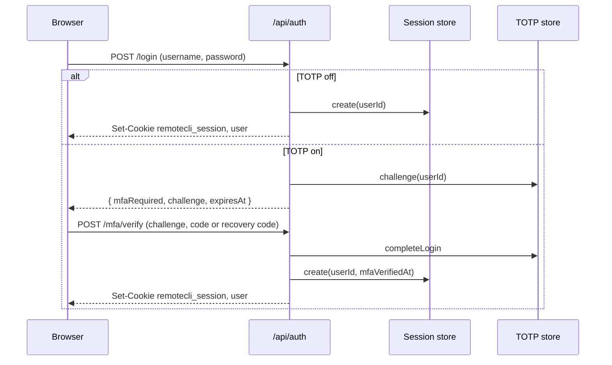

# Auth Module

This guide covers five parts of the auth module:

1. Browser sessions carried in an `HttpOnly` cookie, with expiry, revocation and an idle lock
2. Optional second factor: TOTP authenticator codes plus single-use recovery codes
3. The session lock
4. The request guard in front of every `/api` router
5. The one Remote proxy request that the session cookie authenticates: the HTML preview frame load

Password sign-in, the login limiter, `TRUST_PROXY`, `REMOTECLI_SETUP_TOKEN`, `API_KEY` and the Remote
tab tokens are older parts of the module. This guide names them only where the five parts above use
them.

It is structured like the other backend modules: **small services** under `services/`, two route
adapters (`auth.routes.ts`, `mfa.routes.ts`) and a **barrel export** in `index.ts`.

**On citations.** Claims are anchored to a file path plus a symbol name, never a line number. If a
symbol has moved, grep for it.

---

## Mental model

1. **The browser never holds a bearer token.** Sign-in ends with `Set-Cookie`. The JSON body
   carries no secret. The cookie value is a random 43-character secret that maps to one row in
   `auth_sessions`. Predict from this: frontend code never reads or stores a token. It sends
   `credentials: 'include'` and the request header described in [The request guard](#the-request-guard).
2. **A session is a database row.** The row holds the expiry, revocation and lock state.
   `createSessionStore` in `services/session-store.service.ts` reads and writes it. When a row is
   revoked, the next request with that cookie fails.
3. **Every open transport belongs to a session.** HTTP streams, `/ws`, `/shell` and the Remote
   controller proxy register a close callback with `createSessionConnections`
   (`services/session-runtime.service.ts`). When the session is locked, revoked or expired, every
   registered transport closes. Websockets close with `4403 session-locked` or `4401 session-ended`.
4. **TOTP is opt-in per user.** If TOTP is off, the password creates the session. If TOTP is on, the
   password returns a challenge that expires after 5 minutes, and `POST /api/auth/mfa/verify` creates
   the session. While TOTP is on, a session without `mfaVerifiedAt` counts as signed out.
5. **Locking needs TOTP.** Only an authenticator code unlocks a session. If TOTP is off, `POST /lock`,
   `POST /unlock` and `PUT /auto-lock` answer `409 MFA_DISABLED`.
6. **Sensitive actions need a recent authenticator code.** `requireRecentMfa`
   (`services/mfa-runtime.service.ts`) accepts the session if its last authenticator check is less
   than 10 minutes old (`MFA_FRESH_MS`). If the check is older, it answers `403 MFA_REAUTH_REQUIRED`.
   The client then shows `MfaReauthDialog` and sends the request again.

---

## Public API

`server/modules/auth/index.ts` exports these for sessions, TOTP and the lock:

| Export | Used by |
| --- | --- |
| `createApiSessionGuard` | `server/index.ts`: `app.use('/api', validateApiKey, createApiSessionGuard(authenticateToken))` |
| `getSessionRuntime`, `startSessionExpiry` | Transports that must close with their session; the server lifecycle |
| `isSessionOriginAllowed`, `readAuthTransportConfig` | The websocket upgrade check |
| `assertAuthModeCompatible` | Startup: platform mode refuses to run while any user has TOTP enabled |
| `requireRecentMfa` | Other modules guarding a sensitive action |
| `authenticatePreviewFrame`, `PreviewFrameAuth` (type) | The Remote Controller proxy: the one request it authenticates with the session cookie, see [The Remote preview frame load](#the-remote-preview-frame-load) |
| `secretsMatch` | Constant-time comparison of two secrets |
| `resetTotp` | The `remotecli reset-totp` CLI command only |
| `AuthSession` (type) | Code that reads `req.authSession` |

---

## Service Map

| File | Responsibility |
| --- | --- |
| `auth.module.ts` | Builds the router: `createAuthRouter` plus `createMfaRouter`, wired to the user database |
| `auth.service.ts` | `register`, `login`, `logoutAll`; password rules (`MIN_PASSWORD_LENGTH`), the login limiter, and the hand-off to an MFA challenge |
| `auth.routes.ts` | Sets the cookie on sign-in; session status, `lock` / `unlock`, `auto-lock`, logout, logout-all, the session list |
| `mfa.routes.ts` | TOTP enrollment, activation, sign-in verification, re-verification, disable, recovery codes, password change |
| `auth.middleware.ts` | `authenticateToken` (loopback bearer, platform mode, or session cookie), `authenticateWebSocket`, `validateApiKey` |
| `services/session-transport.service.ts` | Cookie names and attributes, the request header, origin rules, `readAuthTransportConfig` |
| `services/api-session-guard.service.ts` | The `/api` guard: header and origin, content type, locked sessions, sensitive actions |
| `services/preview-frame-auth.service.ts` | `authenticatePreviewFrame`: cookie authentication of the HTML preview frame load for the Remote Controller proxy |
| `services/session-store.service.ts` | The `auth_sessions` table and its policy: create, authenticate, touch, lock, unlock, revoke, expire, idle hours |
| `services/session-runtime.service.ts` | One store per database plus the per-session connection registry; the one-second expiry timer |
| `services/session-lock-policy.service.ts` | `isLockedSessionRouteAllowed`: the four routes a locked session may still call |
| `services/totp-store.service.ts` | Sealed TOTP seeds, challenges, code checks with replay protection, recovery codes, failure throttling |
| `services/mfa-runtime.service.ts` | `getMfaStore`, `requireRecentMfa`, `initializeMfa` |
| `services/reset-totp.service.ts` | Offline reset used by the CLI; never mounted on a router |
| `services/auth-mode.service.ts` | `assertAuthModeCompatible` |
| `services/loopback-token.service.ts` | Bearer for the Host bridge's own requests to `127.0.0.1` |

TOTP seeds are encrypted with the same master key as Remote pairing data:
`getMasterSecret` in `server/modules/remote/storage/master-secret.service.ts`.

---

## Sign-in flow



The server keeps the challenge in memory for 5 minutes (`MFA_CHALLENGE_MS`) and binds it to one
user. A password change calls `invalidateChallenges`. A challenge issued before the change then fails.

---

## The request guard

`createApiSessionGuard` runs before every `/api` router and before the body parsers. It applies these checks in order:

| The request passes if | Otherwise |
| --- | --- |
| `/api/agent/*` and `/api/browser-use-mcp/*` skip the guard. Their own credentials apply | None |
| A loopback bearer (`authKind === 'loopback'`) skips the browser checks | None |
| The request has the header `x-remotecli-request: 1`. If `Origin` is sent, it is allowed. If `Sec-Fetch-Site` is sent, it is `same-origin` | `403 AUTH_REQUEST_FORBIDDEN` |
| The body is `application/json`, or `multipart/form-data` on a route in `MULTIPART_UPLOAD_ROUTES` | `415 AUTH_UNSUPPORTED_MEDIA` |
| A locked session calls only a route that `isLockedSessionRouteAllowed` accepts | `423 AUTH_SESSION_LOCKED` |
| A sensitive action (`isSensitiveAction`) comes with a recent authenticator code | `403 MFA_REAUTH_REQUIRED` |

The public routes `GET /status`, `POST /login`, `POST /register` and `POST /mfa/verify` get the same
browser checks without authentication.

The Local HTML preview page loads into an `iframe`, so the browser cannot add the request header.
`isHtmlPreviewDocumentRequest` matches that exact path when all three Fetch Metadata headers are
present. For that request, the guard skips only the header check.

**Allowed origins.** The server's own origin is always allowed. `REMOTECLI_ALLOWED_ORIGINS` adds
explicit origins. If a request arrives on a loopback address and `TRUST_PROXY` is unset, the guard
also accepts the Vite dev server origin (`http://localhost:<VITE_PORT>`). If an entry is a wildcard
or is malformed, the server stops at startup.

---

## The Remote preview frame load

The Remote Controller proxy (`/r/<peerId>/**` in `server/modules/remote`) authenticates every request with a tab token in the
`Authorization` header. One request cannot carry a header: the browser loading the HTML preview page into an `iframe`.
`authenticatePreviewFrame` in `services/preview-frame-auth.service.ts` authenticates that request with the session cookie.

| Step | Rule | Answer if it fails |
| --- | --- | --- |
| 1 | `isHtmlPreviewDocumentRequest` matches: the method is `GET`, the path is exactly `/api/file-tree/projects/<id>/files/html-preview`, all three Fetch Metadata headers are `same-origin`, `navigate`, `iframe`, and `Origin` is absent or the server's own | The function returns `null` and the proxy keeps its tab token path |
| 2 | The request has no `Authorization` header | `401 AUTH_TOKEN_INVALID` |
| 3 | The cookie names a session that exists, has not expired and has not been revoked | `401 AUTH_TOKEN_INVALID` |
| 4 | The account of the session still exists | `401 AUTH_TOKEN_INVALID` |
| 5 | The session is not locked | `423 AUTH_SESSION_LOCKED` |

The function reads the cookie only. It reads nothing from the URL and sets no cookie.
After step 5 the proxy registers the response with `createSessionConnections`, so a lock, a revoke or a sign-out closes the response.
A locked session cannot use this exception: step 5 refuses it.

---

## Session lifecycle

| Rule | Value | Where |
| --- | --- | --- |
| Absolute lifetime | 7 days from sign-in | `SESSION_MAX_AGE_MS` |
| Idle lock | 24 hours by default, settable from 1 to 168 hours; only while TOTP is on | `DEFAULT_SESSION_IDLE_HOURS`, `setIdleLockHours` |
| Automatic lock default | On | `DEFAULT_SESSION_AUTO_LOCK` |
| Wrong codes on one session (unlock, re-verify, disable TOTP, replace recovery codes) | 5, then the session is revoked: `401 MFA_SESSION_REVOKED`, header `X-Auth-Error: mfa-attempts-exceeded` | `failMfaAttempt` |
| Recent verification window | 10 minutes | `MFA_FRESH_MS` |
| Expiry sweep | Every second. Closes the transports of expired and newly locked sessions | `startSessionExpiry` |

The store writes activity to the database at most every 5 minutes (`ACTIVITY_WRITE_INTERVAL_MS`).
Between writes, the idle check reads the in-memory value.

To turn automatic lock off or to raise the idle hours, the session needs a recent authenticator
code. Lowering the hours needs no code.

The store records each state change in `auth_events` (`locked`, `unlocked`, `logout`, `revoked`,
`expired`, `mfa-attempts-exceeded`, `mfa-disabled`, `recovery-codes-replaced`).

---

## TOTP

| Property | Value |
| --- | --- |
| Algorithm | SHA-1, 6 digits, 30-second period, ±1 step accepted |
| Replay | A step is accepted once: `last_used_step` must increase |
| Enrollment | Needs the password. If TOTP is already on, also needs a recent code. The pending seed expires after 10 minutes and belongs to the enrolling session |
| Activation | Needs the first valid code. Returns 10 recovery codes once. Signs out every other session |
| Recovery codes | 10 codes of 32 hex characters, stored as hashes. Each code works once. Regenerating replaces all 10 and needs a step-up (below) |
| Failure throttle (sign-in and activation) | After 5 failures, the user is blocked for 5 minutes. Each later block doubles, up to 24 hours. Answer: `429 AUTH_RATE_LIMITED` with `Retry-After` |
| Storage | Seeds sealed with the master key; `auth_totp`, `auth_recovery_codes`, `auth_throttle` |
| Disable | Needs a step-up (below). Signs out every other session |
| Platform mode | Not supported. Enrollment answers `409 MFA_PLATFORM_UNSUPPORTED`. If a user already has TOTP on, startup fails |

**Step-up for disabling TOTP and replacing recovery codes.** These two actions weaken the second
factor, so a recent code is not enough. `stepUp` in `mfa.routes.ts` runs these checks in order:

1. TOTP is on. Otherwise: `409 MFA_DISABLED`.
2. The body has the account password (`password`). Otherwise: `403 AUTH_INVALID_CREDENTIALS`.
3. The session has a recent code (`requireRecentMfa`). Otherwise: `403 MFA_REAUTH_REQUIRED`.
4. The body has a new authenticator code (`code`). A recovery code is not accepted. The code goes
   through the same replay guard and per-session attempt counter as `POST /mfa/reauth`. If it is the
   fifth wrong code, the session is revoked.

**Lost authenticator.** Stop the server, then run `remotecli reset-totp` on the host. The command
turns TOTP off for every user, deletes recovery codes and throttle rows, and revokes every browser
session. It writes to the database file directly. No HTTP route calls it.

---

## Routes

All routes are under `/api/auth`. Every response of `mfa.routes.ts` carries `Cache-Control: no-store`.
The table lists the routes this guide covers. `GET /status`, `GET /user` and `POST /refresh` are older
routes and are not listed.

| Method and path | Needs | Effect |
| --- | --- | --- |
| `POST /register`, `POST /login` | Nothing | Session cookie, or `{ mfaRequired, challenge }` |
| `POST /mfa/verify` | Challenge | Completes a TOTP sign-in; sets the cookie |
| `GET /session-status` | Session | `{ locked, totpEnabled, autoLock, idleHours }` |
| `POST /lock` | Session, TOTP on | Locks this session now |
| `POST /unlock` | Locked session, TOTP on | `{ code }` from the authenticator |
| `PUT /auto-lock` | Session, TOTP on | `{ enabled?, idleHours? }` |
| `POST /logout` | Session | Revokes this session, clears the cookie |
| `POST /logout-all` | Session, password, recent code | Revokes every session, bumps the auth epoch |
| `GET /sessions`, `DELETE /sessions/:sessionId` | Session | Lists signed-in browsers; signs one out |
| `GET /mfa/status` | Session | `{ enabled, verifiedAt }` |
| `POST /mfa/enroll` | Session, password | Pending seed, `otpauth` URI, expiry |
| `POST /mfa/activate` | Session | `{ code }`; returns recovery codes |
| `POST /mfa/reauth` | Session | `{ code }`; refreshes the ten-minute window |
| `POST /mfa/disable` | Session, TOTP on, recent code | `{ password, code }`: the password and a new authenticator code. Turns TOTP off |
| `POST /mfa/recovery-codes` | Session, TOTP on, recent code | `{ password, code }`: the password and a new authenticator code. Returns 10 new recovery codes |
| `POST /password` | Session, password, recent code | Changes the password (12 characters to 72 bytes); signs out other sessions |

---

## Client side

| File | Role |
| --- | --- |
| `src/modules/auth/MfaLoginForm.tsx` | Second sign-in step: authenticator or recovery code |
| `src/modules/auth/MfaReauthDialog.tsx` | Asks for a new code when an action answers `MFA_REAUTH_REQUIRED` |
| `src/modules/auth/SessionLockScreen.tsx` | Shown while `session-status` reports `locked` |
| `src/modules/auth/QuickSessionLockButton.tsx` | Header button that calls `POST /lock`. The server locks the session; the UI follows |
| `src/modules/settings/tabs/SessionsSettingsTab.tsx` | Settings → Sessions: signed-in browsers, sign out one or all |
| `src/modules/settings/tabs/TotpSettings.tsx`, `SessionLockSettings.tsx` | Set up, replace or disable TOTP; recovery codes; idle hours and automatic lock |
| `src/modules/settings/tabs/TotpStepUpDialog.tsx` | Asks for the password and a new authenticator code before TOTP is disabled or recovery codes are replaced |

---

## Configuration

| Variable | Effect |
| --- | --- |
| `REMOTECLI_ALLOWED_ORIGINS` | Comma-separated extra origins allowed to call the API with the session cookie, for example a reverse proxy's public origin. Explicit `http(s)://host[:port]` only |
| `REMOTECLI_MASTER_KEY_FILE` | Master key file that seals TOTP seeds and Remote data. Default `~/.remotecli/remote-master.key` |

Over HTTPS the cookie is `__Host-remotecli_session` with `Secure`. Over plain HTTP it is
`remotecli_session`. Both are `HttpOnly; SameSite=Strict; Path=/`. If a sign-in uses plain HTTP from
outside loopback, the server logs a warning.

---

## Gotchas

- **`401` and `403` mean different things to the client.** On `401` the UI signs the user out. So a
  wrong password on an authenticated route answers `403 AUTH_INVALID_CREDENTIALS`.
- **Back up the master key with the database.** If a database is restored without its
  `remote-master.key`, the server cannot open the TOTP seeds. Run `remotecli reset-totp` and enroll
  again.
- **Keep the guard in front of the body parsers.** If `createApiSessionGuard` runs after
  `express.json()`, the server parses a body before the guard can reject it.
- **Keep the locked allowlist short.** `isLockedSessionRouteAllowed` is an exact list of methods and
  paths. A locked screen can reach every entry. Add a route only if the lock screen calls it.
- **Register every new multipart upload route in `MULTIPART_UPLOAD_ROUTES`.** If you skip it, the
  route answers `415`.
- **Keep the preview frame exception to one request.** `authenticatePreviewFrame` reuses
  `isHtmlPreviewDocumentRequest`, the predicate of the Local preview page. If you change that predicate,
  both the Local guard and the Remote proxy change with it.

---

## Tests

Server tests are in `server/modules/auth/tests/` and run with the Node.js test runner. Client tests
are in `src/modules/auth/tests/` and `src/modules/settings/tests/` and run with Vitest.

```bash
# Server
npx tsx --tsconfig server/tsconfig.json --test "server/modules/auth/**/*.test.ts"

# Client
npx vitest run src/modules/auth src/modules/settings
```

`server-environment-bootstrap.test.ts` creates symlinks. On Windows it fails with `EPERM` unless the
account may create symlinks (Developer Mode or an elevated shell).
