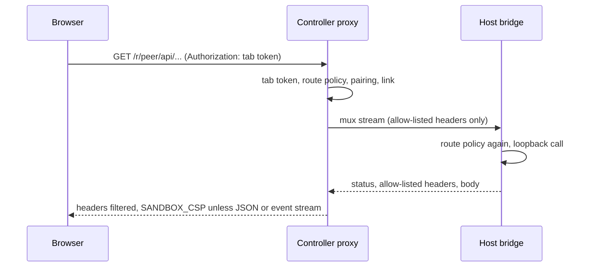

# Remote Module

This guide covers the part of the remote module that carries browser HTTP requests from a Controller to a paired Host:

1. The Controller proxy at `/r/<peerId>/**`
2. The route policy and the header filters that apply to every proxied request
3. The one request that the proxy authenticates with the browser session cookie: the HTML preview page

Pairing, the relay link, the mux frame codec, the crypto code and the management API (`api/`) are older parts of the module.
This guide names them only where the three parts above use them.

**On citations.** Claims are anchored to a file path plus a symbol name, never a line number. If a symbol has moved, grep for it.

---

## Mental model

1. **The Host decides.** The Controller checks a request before it sends it. The Host checks it again with the same table (`createRemoteHttpPolicy`). A modified Controller meets the same rules as an honest one.
2. **Content from the Host is untrusted in the Controller's origin.** `filterResponseHeaders` forces `X-Content-Type-Options: nosniff` and `Cache-Control: no-store` on every proxied response. If the response is not JSON or an event stream, it also gets `SANDBOX_CSP` (`sandbox; default-src 'none'`), so a file opened as a page cannot run a script.
3. **A request has one credential: a tab token.** The browser sends it in the `Authorization` header. The token names one session and one pairing. It lives at most 15 minutes. The proxy never reads a token from the URL.
4. **One request path is the exception.** A signed-in browser that loads the HTML preview page into a frame has no way to add an `Authorization` header. The proxy accepts the session cookie for exactly that request. See [The HTML preview frame load](#the-html-preview-frame-load).
5. **Nothing the Host sends chooses a header of the preview page.** The Controller sets them all.

---

## Public API

`server/modules/remote/index.ts` exports these for the proxy and the policy:

| Export | Used by |
| --- | --- |
| `createRemoteModule` | `server/index.ts`: builds the module once and mounts it after `cors()` |
| `createHostBridge` | The Host side of the module |
| `classifyRoute`, `createRemoteHttpPolicy`, `evaluateRemoteHttpRequest`, `evaluateRemoteWebSocketTarget` | The route policy: the proxy, the bridge and the route inventory test |
| `TARGET_PAGE_CSP` | The policy of the HTML served with `?target=` (the app inside a Remote tab) |

The barrel also exports the pairing, link and storage services. This guide does not cover them.

---

## Service Map

| File | Responsibility |
| --- | --- |
| `controller/controller-proxy.routes.ts` (`createControllerProxyRoutes`) | The `/r/<peerId>` router: authenticate, check the route policy, open a mux stream, copy the response |
| `controller/tab-token.service.ts` (`createTabTokenService`) | Issue and verify tab tokens |
| `controller/peer-registry.service.ts` (`createPeerRegistry`) | Pairing records, link state, `attach`, `forget`, tracked browser connections |
| `policy/route-rules.ts` (`REMOTE_ALLOW_RULES`, `REMOTE_DENY_RULES`) | The route table. Pure data |
| `policy/route-allow-list.ts` (`evaluateRemoteHttpRequest`, `classifyRoute`) | Decide one request: method, canonical path, deny rules, allow rules |
| `policy/path-canonicalizer.ts` | Turn a request target into one canonical path, or refuse it |
| `policy/header-filter.ts` | Header allow-lists in both directions, `SANDBOX_CSP`, and the header set of the preview page |

Other folders (`bridge/`, `link/`, `mux/`, `pairing/`, `crypto/`, `host/`, `runtime/`, `storage/`, `quota/`, `audit/`, `api/`) keep the older parts of the module.

---

## Request flow



The proxy checks these in order. The first failure ends the request:

1. The peer id has the form `[A-Za-z0-9_-]{1,64}`: otherwise 404.
2. The credential: a tab token for this peer, or the preview frame load rules below: otherwise 401.
3. The session is not locked: otherwise 423 for the preview frame load.
4. The local answers (`/health`, `/api/auth/user`, `/api/auth/status`) for a tab token.
5. The route policy: otherwise 403 `REMOTE_FORBIDDEN`.
6. The pairing exists and has not expired, and the link is up: otherwise 404, 410 or 503.

---

## The HTML preview frame load

`GET /api/file-tree/projects/<projectId>/files/html-preview?path=<file>` returns a saved `.html` or `.htm` file as a page for a frame.
The app loads it into an `iframe` with `sandbox="allow-scripts"`.

**Who may call it with the cookie.** The proxy asks `authenticatePreviewFrame` in the auth module. That function accepts the request only if all of these are true:

| Check | Value |
| --- | --- |
| Method | `GET` |
| Path | The exact path above. No decoding, no trailing slash, no other case, no dot segments |
| `Sec-Fetch-Site`, `Sec-Fetch-Mode`, `Sec-Fetch-Dest` | `same-origin`, `navigate`, `iframe` |
| `Origin` | Absent, or equal to the Controller's own origin |
| `Authorization` | Absent |
| Cookie | A session that exists, has not expired, has not been revoked, and belongs to an existing account |

If the method, the path, the Fetch Metadata or the `Origin` do not match, the request is not a frame load and the proxy uses the tab token path.
If they match, the request is a frame load and it never falls back to a token. An `Authorization` header, a missing cookie, and an unknown, expired or revoked session answer `401 AUTH_TOKEN_INVALID`. A locked session answers `423 AUTH_SESSION_LOCKED`.
The cookie is never accepted for another path, and nothing is read from the URL.

**What the browser gets.** If the Host answers 200, the proxy sends exactly these headers (`previewDocumentHeaders`):

| Header | Source |
| --- | --- |
| `Content-Length`, `X-Request-Id` | The Host |
| `Content-Type: text/html; charset=utf-8` | The Controller |
| `Content-Security-Policy` | The Controller: `HTML_PREVIEW_CSP`, exported by the file-tree module. The Local page uses the same constant |
| `X-Content-Type-Options: nosniff`, `Cache-Control: no-store`, `Referrer-Policy: no-referrer`, `Cross-Origin-Resource-Policy: same-origin` | The Controller |

The proxy drops every other Host header, including `Set-Cookie`, `Content-Disposition`, `ETag` and the Host's own policy.
Every other answer for this path carries `SANDBOX_CSP`: a Host answer with another status, also when its body is JSON, and every JSON error that the Controller makes itself.

**What the Host gets.** The proxy removes `Range`, `If-None-Match` and `If-Modified-Since` from this request, so the Host cannot answer 206 or 304.
The cookie and the `Authorization` header never leave the Controller.
The Host handler accepts the loopback bridge as its caller. It does not ask the bridge for Fetch Metadata, because the Controller already checked it.

**A tab-token request for the same path.** The app first asks the page with `fetch` to learn whether it can be served.
That request carries the tab token and gets `SANDBOX_CSP`, never the script-enabled policy.
If the browser sends no Fetch Metadata with it, the proxy answers `400 HTML_PREVIEW_FETCH_METADATA_REQUIRED`, as the Local server does.

---

## Route table

`policy/route-rules.ts` holds the table. A route is allowed only if a rule lists its method and its path. A deny rule wins over an allow rule.

| Route | Methods | Verdict |
| --- | --- | --- |
| `/api/file-tree/projects/*/files/content` | GET | Allow |
| `/api/file-tree/projects/*/files/html-preview` | GET | Allow. Only a signed-in frame load gets the script-enabled policy |

`tests/policy/route-inventory.test.ts` pins the number of rows (`EXPECTED_INVENTORY_ROWS` in `tests/support/route-inventory-table.ts`). If you add a route, add its row and update the pinned number.

---

## Gotchas

1. **Do not change the `cors()` mount in `server/index.ts`.** `app.use('/r', cors({ exposedHeaders: [...] }))` sends `Access-Control-Allow-Origin: *` and no `Access-Control-Allow-Credentials`. Keep it that way. The preview frame load is the only request under `/r/` that a cookie authenticates.
2. **Do not add a header to `REQUEST_HEADER_ALLOW_LIST` for the preview.** The Controller checks Fetch Metadata itself and the Host does not need it.
3. **Do not loosen `SANDBOX_CSP`, `TARGET_PAGE_CSP` or the sandbox of the Remote tab frame.** The preview page is the only response that carries a policy with `allow-scripts`, and the frame never gets `allow-same-origin`.
4. **A new response header for the preview page goes into `previewDocumentHeaders`.** It does not go into `filterResponseHeaders`, which every other response uses.

---

## Tests

```bash
# Server
npx tsx --tsconfig server/tsconfig.json --test "server/modules/remote/tests/**/*.test.ts"
npx tsx --tsconfig server/tsconfig.json --test server/modules/remote/tests/controller/controller-proxy-preview-frame.test.ts

# Real Controller and Host (two processes and a relay)
npx tsx --tsconfig server/tsconfig.json --test tests/e2e-remote/e2e-html-preview-frame.test.ts
```

`controller-proxy-preview-frame.test.ts` uses the production route table (`productionPolicy: true` in `tests/support/proxy-harness.ts`). The other proxy tests use a synthetic table.
