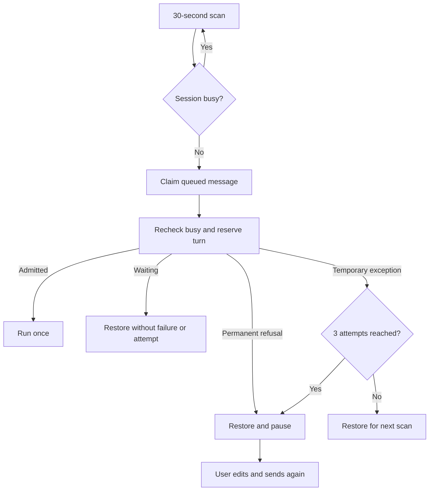

# Scheduled Messages Module

This module sends timed messages and queued follow-ups without an attached browser.

## Mental Model

A schedule claims its due row and starts a detached turn. A queue first waits for app,
background-task and external Claude CLI activity to finish. The queue's retry metadata
lives with the message in `session_drafts.queued_message`; no schema migration is needed.

## Public API

`index.ts` exports `scheduledMessagesRoutes`, `initializeScheduledMessageDispatcher`
and `closeScheduledMessageDispatcher`. `server/index.ts` starts and stops the dispatcher.
The service's exported dispatch functions let tests drive a scan without a timer.

## Service Map

| File | Responsibility |
|---|---|
| `scheduled-messages.routes.ts` | Validate authenticated schedule requests |
| `services/scheduled-messages.service.ts` | Store schedules and announce changes |
| `services/scheduled-message-dispatcher.service.ts` | Claim due work, enforce busy/retry rules, serialize within a session |
| `../database/repositories/session-drafts.db.ts` | Claim and restore queued JSON without dropping newer follow-ups |
| `../websocket/services/chat-websocket.service.ts` | Return typed startup refusals from `runDetachedChatTurn` |

## Routes

Mounted at `/api/scheduled-messages`: GET lists schedules, POST creates one, DELETE
`/:id` cancels or dismisses one. Queue storage uses the existing user-drafts routes.
This change adds no route or environment variable.

## Configuration and Limits

`POLL_INTERVAL_MS` is 30,000. `MAX_STARTUP_ATTEMPTS` is 3 for unknown startup exceptions.
A known permanent refusal pauses immediately. `session-busy` consumes no attempt.
The queue logs when the failure text changes or retry stops. The JSON limit survives
restarts. A fresh user message, including an appended follow-up, resets retry state.

## Gotchas

A registry observation is not a shared lock with an external terminal. A provider
failure after admission is not replayed. A process crash between claim and restore
still needs a durable outbox design. Schedule's `interruptActiveRun` policy is unchanged.

The frontend polls only pending/recovery scopes. A never-queued idle chat has no timer
requests. Recovery becomes a 30-second poll after the 30-second fast window; a mounted
Controller frame can keep that slow watch even when another Host tab is selected.

## Tests

Run `node_modules/.bin/tsx --tsconfig server/tsconfig.json --test server/modules/scheduled-messages/tests/scheduled-messages.test.ts`.
The fixtures use an isolated database and fake runtimes/CLI registry. They do not test
production Hosts.
